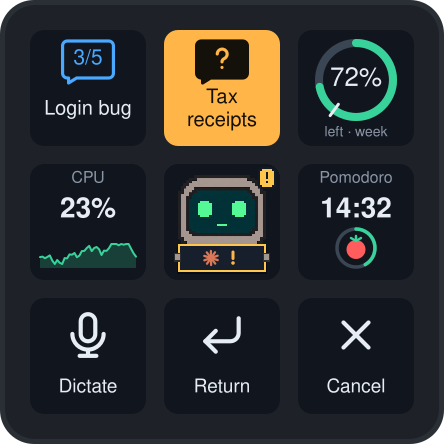
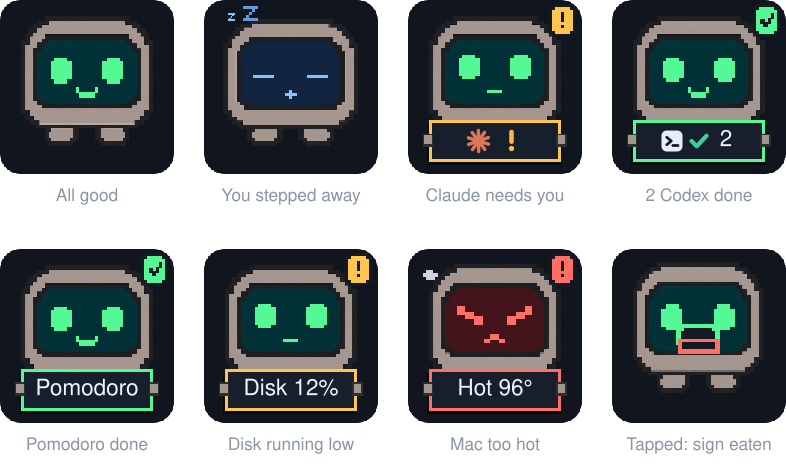

# Keybo

**A desk pet for your MX Creative Keypad that also does real work.**

Keybo is a little pixel robot that lives on one key and keeps an eye on your Mac and your agents. He blinks while
all is well, dozes when you step away, and holds up a sign when something needs you. Tap him and he takes you there.

Around Keybo go the keys he watches over: Claude and Codex session keys with Dictate, Return and Cancel, live Mac
stats, and a few tools. Pick the ones you want; each is its own key.

## What Keybo does

He shows one thing at a time, the most important first: something wrong with the Mac (red), a session waiting on
you (!), a finished Pomodoro, a finished session (✓), then something running low (amber). The count says how many
sessions are waiting or done.

Tap him to deal with it. A session opens, and Keybo leaves it be until it changes state again. A Mac problem gets
eaten and stays quiet for 30 minutes, except memory: when it runs out, walls close in on him, and a tap opens them.
With nothing to show, a tap gets you a gag: there are 39, from Pong to a kaiju attack. Leave him alone long enough
and he'll play one on his own.

Some gags mark the moment: he drops the mic when a session finishes, gets chased by a tomato when a Pomodoro ends,
overflows with coffee when you turn on Keep awake, recharges when he wakes from a doze, and gets jump-started when a
laptop under 20% is plugged in. While a Pomodoro runs he wears a headband and stays focused, with no gags. While an
app records from the mic he wears headphones under a red Live light. When the Mac goes offline he sits holding an
unplugged cable, and cheers when it's back. Press Return and he throws a paper plane.

He has feelings, too. Tap twice quickly for a head pat. Keep tapping and he gives you a look, then huffs, and at
eight taps he throws a tantrum (now and then a censored finger) and sulks for 30 seconds, ignoring you unless
something needs you. Hold him down and
he squishes, flattens to a pancake, and redlines a pressure gauge; let go and he springs back, or launches.

## Keys

In Logi Options+ the keys come in four groups.

### Agents

| Key | Tap | Hold |
|---|---|---|
| Session key 1–6 | Open what's pinned: a Claude session, a Codex thread, a Teams chat, a Safari tab or any app's window. Empty: pin what's in front | Choose: Pin here, Unpin |
| Dictate | Start or stop dictation in the app in front: Claude's mic in Claude, ChatGPT's dictation anywhere else. Faint red arcs ripple round the mic while either is recording | — |
| Return | Press Return in the app in front: sends, or finishes dictation. A soft red dot shows while you're dictating | — |
| Cancel | Press Escape in the app in front: cancels dictation or interrupts | Choose: Archive |
| Usage | Step through your limits: Claude's 5 hours and week, then Codex's | — |

Session key colours: blue dots = working, amber = waiting for you, green = finished, grey = idle.
A small icon on the bubble's top-right corner shows the app: Claude, ChatGPT for Codex, Teams, Safari or any other app. A Teams chat turns green with a dot when it has a new message: pin it with Teams in front and the chat open, and a tap opens it again. Unread only updates while Teams shows its Chat view. Teams keys need Logi Plugin Service allowed under Privacy & Security > Accessibility. A Safari tab shows a small browser window and its title: pin it with Safari in front, and a tap switches back to it, or opens it again if it was closed. The first time, macOS asks to let Logi Plugin Service control Safari: choose OK.

Any other app gets the same small window, with its own icon. A window that shows a file or folder keeps its own name: a
Terminal window shows its directory, and a VS Code window its folder while a file is open in it. Pin it with the window
in front; a tap brings that window back, or opens the app if the window has closed. Any other app's key just says the
app's name, since a window like Messages' changes what it shows, and a tap brings the app forward. The key turns green
with the count when the app's Dock badge is new to you. Once you've looked at the app, with a tap or any other way, the
count stays in grey until it goes up, since some badges, like Calendar's invitations, don't clear when you open the app.
The key goes dark while the app isn't running. It needs the same Accessibility permission as Teams. An empty key always
pins what's in front, so have Claude in front to pin a Claude session.

**Hold to choose.** Hold a session key or Cancel and the key itself steps through its choices, about a second each;
let go on the one you want. A session key offers Pin here (what's in front goes on that key), then Unpin, then
Never mind. Cancel offers Archive (the Claude session on screen), then Never mind. To archive a key's session, tap the
key to open it, then hold Cancel.

**Usage** shows how much is left of your Claude and Codex limits and whether you're on track, with the app's icon in
the corner. The ring is what's left, and the white tick is where an even pace would leave you today. The colour is the
forecast: green, you'll finish under; amber, faster than an even pace; red, you'll run out before it resets, and the
line under the ring says roughly when; grey, the number is out of date. A tap steps through the limits it can read:
Claude's 5 hours and week, then Codex's. A week heading for red takes over the key, whichever app it's from, until you
tap past it. Claude accounts with a spend limit show the month in dollars. It checks every 5 minutes.
Claude's limits need the Claude CLI signed in (`claude auth login`). The first time, macOS asks to let `security` read
"Claude Code-credentials": choose **Always Allow**. Keybo only reads that sign-in while a Usage key is on the keypad,
and never saves or logs it. Codex's limits come from the ChatGPT app, signed in with your ChatGPT account, through the
Codex tool inside it, which handles its own sign-in.

### System

| Key | Shows | Colour |
|---|---|---|
| CPU | Load across all cores, and the last minute as a graph | Green, amber over 70%, red over 90% |
| Memory | GB used, as Activity Monitor counts it. The bar is memory pressure | The bar follows pressure |
| SSD | Free space on the startup disk, as Finder shows it. The bar is space used | Blue, amber under 15% free, red under 5% |
| Network | Download and upload speeds, each with a graph | Blue down, purple up |
| Disk activity | Read and write speeds across all disks, each with a graph | Blue read, purple write |
| Battery | Charge, and the time left or time to full | Green, amber under 20%, red under 10% |
| CPU temp | CPU temperature, and the last two minutes as a graph | Green, amber from 80°, red from 95° |
| GPU | GPU load, and the last minute as a graph | Purple, amber over 70%, red over 90% |
| Busiest app | The app using the most CPU (helpers count toward their app), its icon in a ring that fills at one full core. Tap to open Activity Monitor | Ring green, amber over 100% |
| Connection | Ethernet or Wi-Fi and its link speed; on Wi-Fi, the signal above the noise in dB. With both up, a tap switches between them | Wi-Fi green from 25 dB, amber from 15 dB, red below; red offline |

The stat keys only read the system while one of them is on the keypad.

### Tools

| Key | What it does |
|---|---|
| Mic | The default microphone: Ready (grey) while it's free, Live (red) with the app's icon while an app records from it, Muted (slashed). Muted while an app is still listening glows amber, since it can't hear you. Tap to mute or unmute |
| Sound | The default sound output and its volume: grey while nothing plays, blue with moving waves while an app plays through it, Muted (slashed). Muted while something plays glows amber, since you're missing it. Tap to mute or unmute |
| Keep awake | Tap to keep the Mac and its screen on, with no screen saver or lock, say to watch a long call without touching anything; tap again to let them sleep. The cup steams while on. Starts off whenever the plugin loads |
| Pomodoro | A 25-minute timer. Tap to start, pause or carry on; hold to reset. A sound plays at the end and the key glows green until tapped |

### Pets

| Key | What it does |
|---|---|
| Keybo | See [What Keybo does](#what-keybo-does). Red is heat, critical memory pressure, a full disk, a low battery or CPU flat out; amber is disk or battery running low. Dozes after 10 minutes without input |

## Install

You need a Mac, Logi Options+ (signed in to a Logi account) and an MX Creative Keypad. The Claude keys need the
Claude desktop app; Usage also needs the Claude CLI, and the ChatGPT app for Codex's limits.

### 1. Get the plugin

**From a release (any other Mac).** Download the `.lplug4` file from the
[latest release](https://github.com/vicsz/keybo/releases/latest) and double-click it. Logi Options+ installs it.

**Build it.** Clone this repo somewhere it can stay: the built plugin runs from this folder.

1. `brew install --cask dotnet-sdk`
2. `dotnet tool install --global LogiPluginTool`
3. `cd KeyboPlugin && dotnet build`

Or open the folder in Claude Code and say "install this for me". It reads `AGENTS.md` and does the rest.

### 2. Place the keys

Logi plugins can't ship a layout, so you drag each key on once:

1. Open Logi Options+ and select your keypad.
2. Add a page, or use one with free keys.
3. Open **All actions**, select **Keybo**, and drag the keys you want from **Agents**, **System**, **Tools** and **Pets**.

### 3. Set the dictation shortcuts

Dictate presses `Cmd+D` in Claude (its default) and `Ctrl+Opt+Cmd+D` everywhere else. Set ChatGPT's
Dictation → **Single-tap shortcut** to `Ctrl+Opt+Cmd+D` so Dictate works in any app; skip it if you only use Claude.
ChatGPT's dictation is silent, so Keybo plays Pop when it starts and Bottle when Dictate, Return or Cancel stops it.
While ChatGPT is dictating, Return stops dictation instead of sending; tap it again to send.

### Tip: short session names

Add this to `~/.claude/CLAUDE.md` so session names fit on a key:

    ## Session names
    - Rename the session with the session title tool at the start of a new session, and again right after a fork.
    - 1–3 words, under 16 characters, naming the task: "Login bug", "Tax receipts".
    - A fork gets a name for what it will do next, never "fork", "copy", "v2" or a number.
    - No filler words, dates or emoji.

## Limits

- Mac only.
- **The Claude keys and Keybo's session signs read Claude's and Codex's own files, which are undocumented, so an app
  update can break them.** Hooks would be steadier but need setting up on every machine; Keybo works with nothing to configure.
- Session keys work with Claude Code sessions and Codex threads, not regular chats. Cursor isn't supported: no link opens a local Cursor chat.
- Codex covers the session keys, Return and Cancel. Archive is Claude only.
- Six separate session keys, because a key isn't told where it sits on the keypad.
- The dictation shortcuts are fixed. ChatGPT's stop sound only plays when a keypad key ends dictation.
- Usage reads an undocumented Claude endpoint and Codex's experimental app server, so an update can break either. It
  goes grey rather than show a wrong number.
- CPU is the share of all cores. Busiest app counts one core as 100%, so a busy app can show over 100%.
- Network counts Wi-Fi and Ethernet, not VPN tunnels. Wi-Fi's link speed moves around, as macOS reports it.
- CPU temp uses a private macOS API, so an update could break it.
- Mic and Sound mute only the default microphone and sound output. One with no mute switch is muted by setting its volume to zero; if the plugin restarts while it's muted, unmuting sets 75% for a mic and 25% for speakers. An output with no volume control, as on many displays, shows Fixed.
- Live and the moving waves mean an app has the device open, not that anything is audible: a call keeps both on throughout. Mic's app icon needs macOS 14.2 or later.
- Keep awake works like `caffeinate -d -u` from inside the plugin, so it also holds off a screen lock that your company sets. If the plugin quits, the Mac can sleep and lock again.
- Battery shows "no battery" on desktop Macs.
- The keypad goes blank while the Mac is locked.
